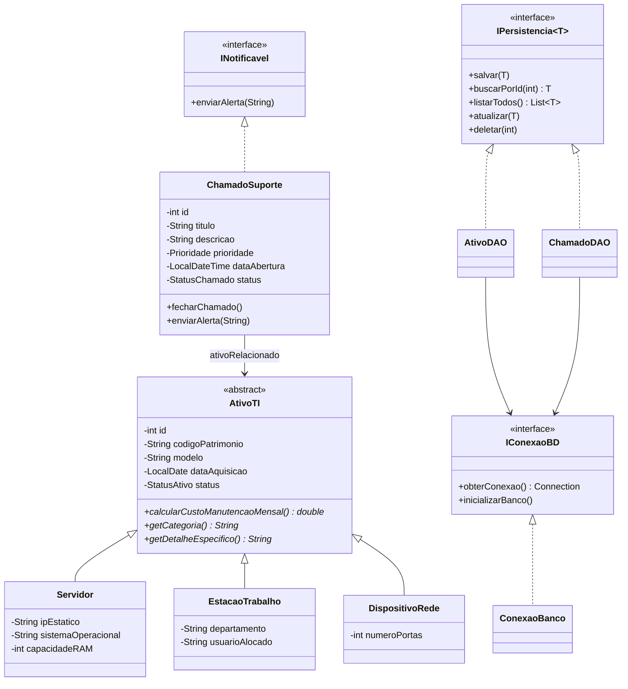

# TechLab Inventory & Service Desk

Projeto da disciplina **Programação Orientada a Objetos e Persistência (2026.2)**.

Sistema de console em Java para gerenciar o inventário de ativos de TI (servidores, estações de trabalho e dispositivos de rede) e os chamados de suporte técnico, com persistência em banco de dados SQLite e exportação/importação em arquivo CSV.

## Funcionalidades

- Cadastro, listagem, busca, atualização e remoção de ativos (CRUD completo)
- Abertura, listagem com filtros, fechamento e remoção de chamados
- Painel de chamados abertos agrupados por prioridade
- Relatório de custo mensal de manutenção (cálculo polimórfico por tipo de ativo)
- Exportação dos ativos para CSV e importação a partir de CSV
- Regras de negócio:
  - chamado de prioridade **Alta** coloca o ativo em manutenção e dispara um alerta;
  - ao fechar o último chamado aberto, o ativo volta ao status **Ativo**;
  - não é possível abrir chamado para ativo **Descartado**;
  - patrimônio é único; remover um ativo remove também os seus chamados (`ON DELETE CASCADE`).

## Conceitos de POO aplicados

| Conceito | Onde |
| :--- | :--- |
| Encapsulamento e validação | atributos `private` + setters com validação em `negocio/` |
| Sobrecarga de construtores | todas as classes de `negocio/` (construtor completo e de cadastro) |
| Herança | `Servidor`, `EstacaoTrabalho` e `DispositivoRede` estendem `AtivoTI` |
| Abstração | `AtivoTI` é abstrata (`calcularCustoManutencaoMensal`, `getCategoria`, `getDetalheEspecifico`) |
| Polimorfismo | relatório de custos e `toString()` de cada subclasse |
| Interfaces | `INotificavel`, `IConexaoBD`, `IPersistencia<T>` |
| Exceções personalizadas | `EquipamentoNaoEncontradoException`, `ChamadoNaoEncontradoException`, `FalhaConexaoBDException` |
| Enums | `StatusAtivo`, `Prioridade`, `StatusChamado` |
| Coleções e genéricos | `GerenciadorChamados` (`List`, `Map`, `Iterator`) e `IPersistencia<T>` |
| DTO e casting | `AtivoDTO` + `AtivoMapper` |
| Persistência em arquivo | `ArquivoCSV` |
| Padrão DAO + JDBC | `AtivoDAO` e `ChamadoDAO` com `PreparedStatement` (proteção contra SQL Injection) |

## Estrutura

```
Techlab/
├── Main.java                 menu de console
├── negocio/                  entidades e enums
├── interfaces/               INotificavel, IConexaoBD, IPersistencia<T>
├── excecoes/                 exceções personalizadas
├── db/                       ConexaoBanco (SQLite)
├── dao/                      AtivoDAO, ChamadoDAO
├── dto/                      AtivoDTO, AtivoMapper
├── servico/                  GerenciadorChamados
└── arquivo/                  ArquivoCSV
dados/ativos_exemplo.csv      carga inicial de exemplo
lib/sqlite-jdbc.jar           driver JDBC do SQLite
```

## Diagrama de classes



## Banco de dados

O arquivo `techlab.db` é criado automaticamente na primeira execução.

```sql
CREATE TABLE ativos (
    id INTEGER PRIMARY KEY AUTOINCREMENT,
    patrimonio TEXT NOT NULL UNIQUE,
    modelo TEXT NOT NULL,
    categoria TEXT NOT NULL,          -- Servidor | EstacaoTrabalho | DispositivoRede
    status TEXT NOT NULL,             -- ATIVO | EM_MANUTENCAO | DESCARTADO
    data_aquisicao TEXT NOT NULL,     -- aaaa-mm-dd
    detalhe_especifico TEXT NOT NULL  -- atributos da subclasse separados por |
);

CREATE TABLE chamados (
    id INTEGER PRIMARY KEY AUTOINCREMENT,
    titulo TEXT NOT NULL,
    descricao TEXT NOT NULL,
    prioridade TEXT NOT NULL,         -- BAIXA | MEDIA | ALTA
    status TEXT NOT NULL,             -- ABERTO | FECHADO
    data_abertura TEXT NOT NULL,
    ativo_id INTEGER NOT NULL,
    FOREIGN KEY (ativo_id) REFERENCES ativos(id) ON DELETE CASCADE
);
```

## Como executar

Requisito: JDK 17 ou superior.

**Windows** (na raiz do repositório):

```
executar.bat
```

**Git Bash / Linux / macOS:**

```
./executar.sh
```

Ou, com `make` instalado: `make run`.

**Manualmente:**

```
javac -encoding UTF-8 -d bin Techlab/*.java Techlab/*/*.java
java --enable-native-access=ALL-UNNAMED -cp "bin;lib/sqlite-jdbc.jar" Techlab.Main     (Windows)
java --enable-native-access=ALL-UNNAMED -cp "bin:lib/sqlite-jdbc.jar" Techlab.Main     (Linux/macOS)
```

Para começar com dados de exemplo, use a opção **13 - Importar ativos de CSV** e pressione Enter para carregar `dados/ativos_exemplo.csv`.
